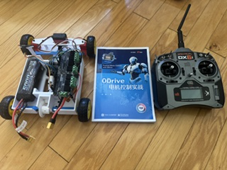
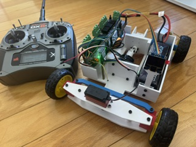
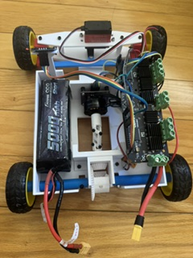

# ODrive 电机控制实战 · odrive_study

本仓库是《ODrive 电机控制实战》（作者：张闽，电子工业出版社出版）的**配套资源仓库**，同时也是一个**基于 ODrive v0.5.6 开源固件整理精简的学习版固件工程**（编译目标 `odrive_min`），面向 ODrive v3.6 硬件（主控 STM32F405 @ 168 MHz，双轴 BLDC FOC 控制器）。

你可以把它当作两种东西来用：

- **跟着书学**：按书籍章节动手实践，配套代码、3D 打印模型和演示视频都在本仓库中；
- **读源码学**：对照源码深入理解 FOC 磁场定向控制、STM32 外设（ADC / TIM / SPI / CAN）、FreeRTOS 任务调度和电机固件工程组织。

<p align="center">
  
  
  
</p>

## 目录结构

| 目录                                  | 说明                                                                                                                                           |
| ------------------------------------- | ---------------------------------------------------------------------------------------------------------------------------------------------- |
| `MotorControl/`                     | 核心控制逻辑：轴状态机（axis）、电机（motor）、编码器（encoder）、控制器（controller）、FOC、无感估计、梯形轨迹规划等，固件入口在 `main.cpp` |
| `Board/v3/`                         | ODrive v3 板级支持代码：CubeMX 生成的外设初始化（`Src/`、`Odrive.ioc`）、时钟与 GPIO 配置、链接脚本                                        |
| `Drivers/`                          | 栅极驱动芯片驱动：`DRV8301`（原版支持）、`EG2134`（本仓库新增支持）                                                                        |
| `communication/`                    | 通信协议：ASCII 协议、USB CDC、UART、CAN、I2C                                                                                                  |
| `fibre-cpp/` + `autogen/`         | ODrive 的 Fibre RPC 框架，接口代码由 `odrive-interface.yaml` 自动生成                                                                        |
| `ThirdParty/`                       | 第三方库：FreeRTOS、STM32F4 HAL、CMSIS、USB 设备库                                                                                             |
| `Display/`                          | 书中 RC 小车项目使用的 OLED 显示驱动                                                                                                           |
| `tools/`                            | odrivetool、Fibre 接口代码生成器、OdrvStudio 桌面调试 GUI、CAN DBC 生成器（`gen_can_dbc.py`）、环境配置脚本                                    |
| `Doc/`                              | 学习笔记与使用指南（见下文"学习文档"）                                                                                                         |
| `3dprintmodel_demo_fromOdrivebook/` | 书中最终项目（3D 打印小车）的模型文件、照片与演示视频                                                                                          |

## 硬件准备

- ODrive v3.6 控制板（含 56V 版本）
- 云台电机（书中使用 2804 无刷电机）
- 编码器（书中使用 AS5047P 磁编码器）
- 直流电源、ST-Link V2 调试器、Micro USB 数据线

## 快速开始

### 1. 环境搭建

一键安装编译工具链（arm-none-eabi-gcc、make、openocd、gdb-multiarch），并创建 `~/.odrive-venv` 虚拟环境安装 odrivetool：

```bash
bash tools/setup_env.sh            # 基础配置
bash tools/setup_env.sh --with-udev  # 同时安装 ODrive USB 权限规则（需要 sudo）
```

### 2. 编译固件

```bash
make -j$(nproc)
# 产物：build/odrive_min.elf / .hex / .bin
```

### 3. 烧录与调试

通过 OpenOCD + ST-Link V2 烧录：

```bash
# 解锁芯片（首次烧录被读保护的板子需要）
openocd -s /usr/share/openocd/scripts -f interface/stlink.cfg -f target/stm32f4x.cfg \
    -c init -c 'reset halt' -c 'stm32f4x unlock 0'

# 烧录
openocd -s /usr/share/openocd/scripts -f interface/stlink.cfg -f target/stm32f4x.cfg \
    -c init -c 'reset halt' \
    -c 'flash write_image erase build/odrive_min.elf' -c 'reset run' -c exit
```

调试推荐 VSCode + OpenOCD + Cortex-Debug，配合 `gdb-multiarch` 进行断点调试（详见 `Doc/readme_please.txt`）。

### 4. 使用 odrivetool

```bash
~/.odrive-venv/bin/odrivetool
```

连上后设备对象为 `dev0`，常用指令示例：

```python
dev0.axis0.requested_state = AXIS_STATE_MOTOR_CALIBRATION    # 电机校准
dev0.axis0.requested_state = AXIS_STATE_ENCODER_OFFSET_CALIBRATION  # 编码器偏置校准
dev0.axis0.requested_state = AXIS_STATE_CLOSED_LOOP_CONTROL  # 进入闭环控制
dev0.axis0.controller.input_pos = 5                          # 位置指令（圈数）
```

完整命令清单、校准流程与错误码排查见 `Doc/odrive_commands_usage_guide.md`。

## OdrvStudio 桌面调试工具

本仓库附带一个参考 SimpleFOCStudio 开发的 ODrive 桌面调试工作台（PySide6 + PyQtGraph），针对 ODrive v3.6 + 2804 云台电机 + AS5047P 适配，支持双轴监控、参数配置与曲线绘图：

```bash
./tools/odrvstudio.sh                # Linux / WSL
tools\run_odrvstudio.bat             # Windows，双击运行
```

详见 `tools/OdrvStudio/README.md`。

## CAN 总线调试：DBC 文件生成

固件的 CAN 协议（CANSimple）可以通过脚本生成标准 DBC 文件，供 SavvyCAN、cantools、CANoe 等工具解码总线报文。命令 ID 从 `communication/can/can_simple.hpp` 的枚举、枚举值从 `odrive-interface.yaml` 自动提取，与固件源码保持同步：

```bash
python3 tools/gen_can_dbc.py                          # 单轴（node 0）→ Doc/odrive_can.dbc
python3 tools/gen_can_dbc.py --axes 2 --check         # 双轴小车（node 0 + 1），并用 cantools 校验
python3 tools/gen_can_dbc.py --node-id 3 --extended   # 29 位扩展帧
```

生成的 `Doc/odrive_can.dbc` 已用 cantools 验证（29 条消息 / 41 个信号，双轴版翻倍），float32 遥测、int16 缩放信号和枚举名均可正确解码：

```bash
~/.odrive-venv/bin/python tools/gen_can_dbc.py --axes 2 --check   # 校验（需 ~/.odrive-venv/bin/pip install cantools）
~/.odrive-venv/bin/cantools dump Doc/odrive_can.dbc               # 查看 DBC 内容
~/.odrive-venv/bin/cantools decode Doc/odrive_can.dbc 9 0011223344556677   # 解码单帧（示例）
```

使用注意：

- 帧地址为 `(node_id << 5) | cmd_id`（6 位节点 ID + 5 位命令 ID），`--extended` 时再加 0x80000000 标志
- float32 信号通过 DBC 扩展 `SIG_VALTYPE_` 标记，cantools / SavvyCAN 可原生解码，个别老工具会显示为原始 uint32
- 查询类消息（电机/编码器错误码、编码器估计等）按 ODrive 发出的**响应帧**建模，触发方式（RTR 帧或同 ID 空帧）见 DBC 内注释

## 书中最终项目：3D 打印小车

书中最后完成了一个 3D 打印底盘的 ODrive 小车项目，模型文件、实物照片和演示视频都在 `3dprintmodel_demo_fromOdrivebook/` 目录中：

- [观看演示视频](3dprintmodel_demo_fromOdrivebook/videos/IMG_4448.mov)

## 学习文档

| 文档                                    | 内容                                                               |
| --------------------------------------- | ------------------------------------------------------------------ |
| `Doc/Odrive.md`                       | 仓库总览与固件完整运行流程梳理（从上电到闭环控制，含代码位置对照） |
| `Doc/odrive_commands_usage_guide.md`  | odrivetool 命令怎么用：在哪儿敲、每一步看什么、出错怎么查          |
| `Doc/odrive_2804_as5047p_commands.md` | 2804 + AS5047P 的完整命令清单、参数表与错误码                      |
| `Doc/ODrive移植说明v0.5.6.pdf`        | ODrive v0.5.6 移植说明                                             |
| `Doc/readme_please.txt`               | 编译烧录调试备忘                                                   |
| `Doc/栅极驱动器移植说明.md`           | EG2134 / DRV8301 编译期切换机制、硬件差异与新增驱动芯片步骤        |
| `Doc/固件版本号生成说明.md`           | 版本号从 git tag 到固件/上位机的完整生成链路、各层读取方式与踩坑   |
| `Doc/odrive_can.dbc`                  | CAN 协议 DBC 文件（由 `tools/gen_can_dbc.py` 生成，见下文）        |

## 配套视频与图书

- [教学视频（B站）](https://www.bilibili.com/video/BV1M9QtYwEVo?spm_id_from=333.788.videopod.sections&vd_source=f3cac93aa19596ae6543cfeb95b829d7)
- [书籍介绍视频（B站）](https://www.bilibili.com/video/BV1UKFkzEE4T/?spm_id_from=333.1387.0.0&vd_source=f3cac93aa19596ae6543cfeb95b829d7)
- [购买正版图书《ODrive 电机控制实战》](https://mall.bilibili.com/neul-next/detailuniversal/detail.html?isMerchant=1&page=detailuniversal_detail&saleType=0&itemsId=40330749&loadingShow=1&noTitleBar=1&track_id=__BGMT__&from=&from_spmid=__SPMID__&msource=cps_comments_3546707220498944_cont-1-116022233268364)

本书已由电子工业出版社正式出版。如果这本书或本仓库对你有帮助，欢迎支持正版购买——你的支持是我继续更新资料、完善示例代码、制作更多电机控制与机器人内容的动力。

## 勘误与反馈

由于硬件版本、固件版本和工具链可能持续变化，本仓库内容也会不定期更新。如果你发现书中或代码中的错误，欢迎提交 Issue 或 Pull Request。提交问题时建议包含：

1. ODrive 硬件版本
2. 固件版本
3. 操作系统环境
4. 电机与编码器型号
5. 具体错误信息或现象
6. 已尝试过的解决方法

这样可以更快定位问题。

## 作者

**张闽（Min Zhang）** —— 长期关注电机控制、嵌入式系统、机器人、操作系统和底层软件技术，持续分享相关学习资料与项目实践。

- B站：https://space.bilibili.com/3546707220498944
- Udemy：https://www.udemy.com/course/build-an-300-lines-operating-system-from-scratch-x86-base/
- GitHub：https://github.com/embedded-idea

## 许可说明

固件部分基于 [ODrive](https://github.com/odriverobotics/ODrive) v0.5.6 开源固件（MIT License）修改，仅用于学习交流；书籍内容版权归作者与电子工业出版社所有。
